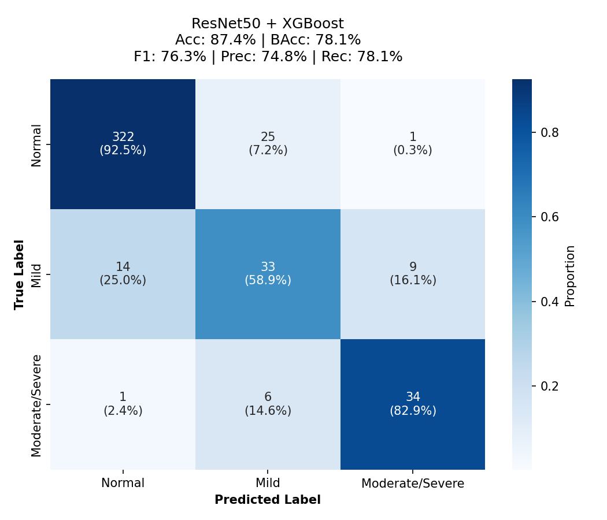
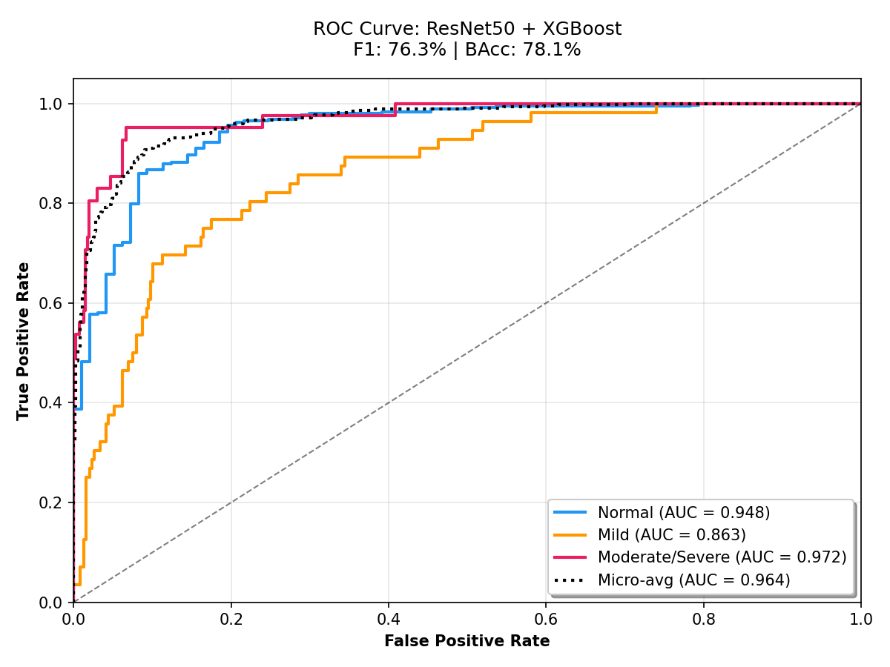
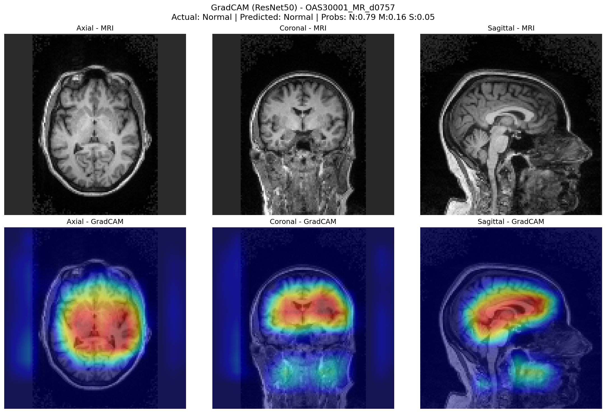
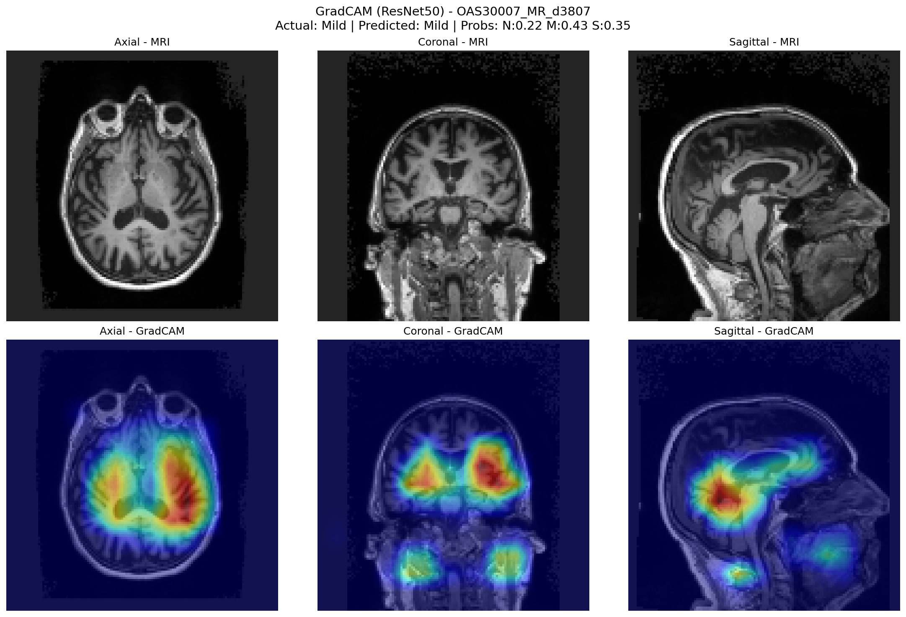
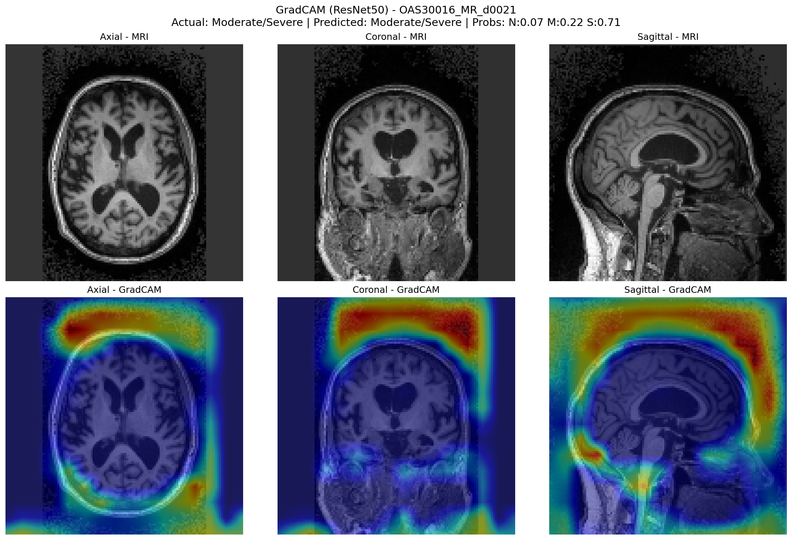

# 🧠 Alzheimer Hastalığının Erken Tespitinde 3D CNN ve Makine Öğrenmesi Tabanlı Çok Modelli Geç Füzyon Mimarisi (OASIS-3)

**A Multimodal Late-Fusion Architecture for Early Alzheimer Detection: A Comprehensive Study on OASIS-3**

📄 **[Tam Metin Makaleyi İncele (`paper.pdf`)](paper.pdf)**

Bu proje, **OASIS-3** boylamsal (longitudinal) nörogörüntüleme veri setindeki **3D yapısal T1w MRI taramaları** ile **klinik/bilişsel tablo verilerini** birleştirerek Alzheimer hastalığının evrelerini yüksek doğrulukla ve sızıntısız (*leakage-free*) bir metodolojiyle sınıflandıran uçtan uca bir derin öğrenme ve karar destek sistemidir.

---

## 🎯 Öne Çıkan Katkılar

- **Kapsamlı Multimodal Karşılaştırma (14 Kombinasyon):** 2 farklı 3D MRI mimarisi (**Custom 3D CNN** ve **MedicalNet Pretrained ResNet50**) ile 7 farklı klinik model (**XGBoost, LightGBM, CatBoost, Random Forest, TabNet, FT-Transformer, MLP**) ayrı ayrı eğitilmiş ve **Ağırlıklı Geç Füzyon (Weighted Late-Fusion)** ile 14 farklı MRI × Klinik kombinasyonu sistematik olarak değerlendirilmiştir.
- **Sıfır Veri ve Hedef Sızıntısı (Zero Data & Target Leakage):** Boylamsal veri setlerinde aynı hastanın farklı ziyaretlerinin hem eğitim hem test setine düşmesini engellemek için **`StratifiedGroupKFold`** ile hasta bazlı izolasyon uygulanmış; tanı hedefini doğrudan ele veren değişkenler (CDR-SB, MMSE, dx* vb.) veri ön işleme aşamasında çıkarılmıştır.
- **Optuna ile Hiperparametre Optimizasyonu:** Tüm derin öğrenme ve karar ağacı modelleri `Optuna` (`MedianPruner`) ile optimize edilmiştir.
- **Açıklanabilir Yapay Zekâ (XAI):** 3D MRI üzerinde **Grad-CAM** ısı haritaları (hipokampal atrofi, lateral ventrikül genişlemesi, kortikal incelme) ve klinik modellerde **Özellik Önem Analizi (Feature Importance)** ile karar mekanizmasının klinik şeffaflığı sağlanmıştır.
- **Uçtan Uca Klinik Karar Destek Uygulamaları:** Model çıktıları hem **Flutter + FastAPI Mobil Uygulaması** hem de **Streamlit Web Arayüzü** üzerinden hekim kullanımına sunulmuştur.

---

## 📊 Veri Seti ve Sınıf Dağılımı (OASIS-3)

Washington Üniversitesi Knight ADRC tarafından sunulan **OASIS-3** veri setinden yaşları 42–95 arasında değişen **1.360 hastaya** ait **3.692 multimodal kayıt** (±180 gün MRI–Klinik eşleştirme toleransı ile) kullanılmıştır.

| Sınıf | CDR Skoru | Örnek Sayısı | Oran (%) | Eğitim / Test Bölünmesi | Açıklama |
| :--- | :---: | :---: | :---: | :---: | :--- |
| **Normal (CN)** | `0` | 2,950 | %79.9 | 2,360 / 590 | Bilişsel olarak sağlıklı bireyler |
| **Hafif (MCI)** | `0.5` | 469 | %12.7 | 375 / 94 | Çok hafif / hafif bilişsel bozukluk |
| **Orta / Ağır (AD)** | `≥ 1.0` | 273 | %7.4 | 218 / 55 | Orta ve ağır evre Alzheimer demansı |
| **Toplam** | — | **3,692** | **%100** | **2,953 / 739** | Hasta bazlı izole edilmiş dağılım |

---

## 🏗️ Metodoloji ve Mimari

### 1. Veri Ön İşleme Hattı (`scripts/preprocessing/`)
1. **`01_merge_clinical_tables.ipynb`:** 18 farklı OASIS-3 UDS tablosunun `OASISID × age_at_visit` anahtarı üzerinden birleştirilmesi ve >%20 eksik sütunların elenmesi.
2. **`02_impute_clinical_data.ipynb`:** Eksik klinik verilerin hasta bazlı ileri doldurma (*forward-fill*) yöntemiyle tamamlanması.
3. **`03_match_mri_sessions.ipynb`:** MRI oturumlarının CDR etiketleri ve ziyaret günleriyle eşlenmesi.
4. **`04_encode_categorical_and_meds.ipynb`:** Kategorik değişkenlerin kodlanması ve 2.692 benzersiz ilaç isminin `nn.Embedding (16D)` ile vektörleştirilmesi.
5. **`05_merge_mri_and_clinical.ipynb`:** MRI oturum yolları ile klinik özellik tablosunun birleştirilmesi.
6. **`06_reduce_med_embeddings_pca.py` & `07_integrate_pca_embeddings.py`:** 16 boyutlu ilaç gömmelerinin **PCA (8 bileşen)** ile sıkıştırılıp ana veri setine entegre edilmesi.
7. **`08_preprocess_mri_volumes_128.py`:** 3D T1w MRI taramalarının RAS standart oryantasyonuna getirilmesi, `1×1×1 mm` izotropik voksel yeniden örnekleme, beyin dokusu kırpma, `%1–%99.5` yoğunluk kırpma, Z-skoru normalizasyonu ve `128×128×128` boyutlandırma.
8. **`09_remove_target_leakage.py`:** Hedef sızıntısına yol açan `CDRSUM`, `CDRTOT`, `MMSE`, `orient`, `dx*` sütunlarının veri setinden temizlenmesi (84 nihai özellik).
9. **`10_align_mri_clinical_180d.py`:** MRI çekim tarihi ile klinik ziyaret tarihi arasında ±180 gün tolerans kontrolü ve MRI bazında tekilleştirme.

### 2. Model Mimarileri (`scripts/train/`)
- **Custom 3D CNN (`mr/custom_3dcnn_train.py`):** Küçük yığın boyutlarında kararlılık sağlayan `InstanceNorm3d` + `GroupNorm`, 4 aşamalı Residual bloklar (`32 → 64 → 128 → 256` kanal), bölgesel atrofiye odaklanan **Squeeze-and-Excitation (SE)** kanal dikkat blokları ve kademeli `Dropout3D`. (~8.2M parametre)
- **ResNet50 - MedicalNet 3D (`mr/resnet50_medicalnet_train.py`):** 23 tıbbi veri seti üzerinde ön-eğitimli 3D ResNet50 omurgası; *catastrophic forgetting*'i önlemek için **3 Fazlı Kademeli Katman Çözme (Gradual Unfreezing)**, `LayerNorm + GELU` sınıflandırıcı başlığı, Mixed Precision, Gradient Accumulation ve **EMA** (`decay=0.998`) ile ince ayar yapılmıştır.
- **Klinik Modeller (`clinical/`):** `XGBoost`, `LightGBM`, `CatBoost`, `Random Forest`, `TabNet`, `FT-Transformer` ve 5 katmanlı `MLP` (Balanced Focal Loss + QuantileTransformer).

### 3. Ağırlıklı Geç Füzyon (`scripts/train/fusion/`)
Baskın modalite (*modality dominance*) sorununu aşmak için bağımsız optimize edilen MRI ve klinik modellerin olasılık çıktıları karar aşamasında birleştirilir:

$$P_{\text{final}} = \alpha \cdot P_{\text{MRI}} + (1 - \alpha) \cdot P_{\text{Clinical}}, \quad \alpha = 0.30$$

---

## 🏆 Deneysel Sonuçlar

Sınıf dengesizliği nedeniyle birincil metrik olarak **Dengeli Doğruluk (Balanced Accuracy - BAcc)** baz alınmıştır:

| Model Konfigürasyonu | Accuracy (%) | Balanced Acc (%) | Precision (%) | Recall (%) | F1-Skoru (%) | ROC-AUC | 5-Katlı CV BAcc |
| :--- | :---: | :---: | :---: | :---: | :---: | :---: | :---: |
| **ResNet50 + XGBoost (En İyi BAcc)** | 87.42 | **78.13** | 74.79 | 78.13 | **76.34** | **0.964** | **76.8 ± 2.1** |
| **Custom3DCNN + Random Forest (En İyi Acc)** | **88.76** | 75.64 | **77.60** | 75.64 | 75.84 | 0.951 | 74.2 ± 2.8 |
| **ResNet50 + LightGBM** | 86.29 | 77.15 | 72.20 | 77.15 | 74.42 | 0.958 | 75.8 ± 2.3 |
| **XGBoost (Yalnızca Klinik)** | 86.74 | 76.84 | 72.45 | 76.84 | 74.45 | 0.961 | 75.4 ± 3.1 |
| **ResNet50 + FT-Transformer** | 84.94 | 76.70 | — | — | — | — | 75.1 ± 3.4 |
| **Custom3DCNN + XGBoost** | 85.84 | 75.96 | — | — | — | — | 74.6 ± 2.9 |
| **ResNet50 + CatBoost** | 86.97 | 74.35 | 74.21 | 74.35 | 74.16 | 0.961 | 73.2 ± 3.1 |
| **Custom3DCNN (Yalnızca MRI)** | 68.09 | 55.01 | — | — | — | 0.813 | 54.2 ± 5.1 |
| **ResNet50 (Yalnızca MRI)** | 71.24 | 50.33 | — | — | — | 0.854 | 49.6 ± 5.8 |

### Görselleştirmeler ve Açıklanabilir Yapay Zekâ (Grad-CAM)

| En İyi Füzyon Karmaşıklık Matrisi | En İyi Füzyon ROC Eğrisi |
| :---: | :---: |
|  |  |

| Normal (CN) Grad-CAM | Hafif (MCI) Grad-CAM | Orta/Ağır (AD) Grad-CAM |
| :---: | :---: | :---: |
|  |  |  |

---

## 🗂️ Proje Dizin Yapısı

```text
Bitirme_Projesi/
├── paper.pdf                                           # Çalışmanın tam metin akademik makalesi
├── graphics/                                           # Makale görselleri (ROC, Confusion Matrix, Grad-CAM, Feature Importance)
├── scripts/
│   ├── preprocessing/                                  # 10 adımlı veri hazırlama ve sızıntı önleme hattı
│   │   ├── 01_merge_clinical_tables.ipynb
│   │   ├── 02_impute_clinical_data.ipynb
│   │   ├── 03_match_mri_sessions.ipynb
│   │   ├── 04_encode_categorical_and_meds.ipynb
│   │   ├── 05_merge_mri_and_clinical.ipynb
│   │   ├── 06_reduce_med_embeddings_pca.py
│   │   ├── 07_integrate_pca_embeddings.py
│   │   ├── 08_preprocess_mri_volumes_128.py
│   │   ├── 09_remove_target_leakage.py
│   │   └── 10_align_mri_clinical_180d.py
│   │
│   ├── train/
│   │   ├── clinical/                                   # 7 klinik modelin Optuna optimizasyon, eğitim ve test kodları
│   │   │   ├── configs/                                # Optuna tarafından seçilen en iyi hiperparametreler (*.json)
│   │   │   ├── xgboost_{optuna_tuning,train,evaluate}.py
│   │   │   ├── lightgbm_{optuna_tuning,train,evaluate}.py
│   │   │   ├── catboost_{optuna_tuning,train,evaluate}.py
│   │   │   ├── random_forest_{optuna_tuning,train,evaluate}.py
│   │   │   ├── tabnet_{optuna_tuning,train,evaluate}.py
│   │   │   ├── ft_transformer_{optuna_tuning,train,evaluate}.py
│   │   │   └── mlp_{optuna_tuning,train,evaluate}.py
│   │   │
│   │   ├── mr/                                         # 3D MRI modelleri ve XAI görselleştirme
│   │   │   ├── custom_3dcnn_{train,evaluate}.py
│   │   │   ├── resnet50_medicalnet_{optuna_tuning,train,evaluate}.py
│   │   │   └── gradcam_3d_visualize.py
│   │   │
│   │   ├── fusion/                                     # 14 Geç Füzyon kombinasyonu ve modalite ablasyon analizi
│   │   │   ├── evaluate_late_fusion.py
│   │   │   ├── ablation_modality_analysis.py
│   │   │   └── fusion_results.csv
│   │   │
│   │   ├── custom_model.py                             # Custom 3D CNN mimari tanımı
│   │   └── mri_pipeline.py                             # 3D MRI yükleme ve ön işleme yardımcı fonksiyonları
│
├── mobil-app/                                          # Uçtan uca Mobil & Masaüstü Karar Destek Sistemi
│   ├── backend/                                        # FastAPI multimodal tahmin (inference) sunucusu
│   ├── frontend/                                       # Flutter kullanıcı arayüzü
│   └── inference/                                      # Örnek hasta test verileri
├── website/                                            # Streamlit web karar destek arayüzü
│   └── scripts/
│       ├── app.py
│       └── utils.py
└── README.md
```

---

## 🚀 Kurulum ve Kullanım

### 1. Gereksinimler
```bash
pip install torch monai numpy pandas scikit-learn xgboost lightgbm catboost pytorch-tabnet optuna matplotlib seaborn tqdm fastapi uvicorn streamlit
```

### 2. Veri Ön İşleme
```bash
python scripts/preprocessing/06_reduce_med_embeddings_pca.py
python scripts/preprocessing/07_integrate_pca_embeddings.py
python scripts/preprocessing/08_preprocess_mri_volumes_128.py
python scripts/preprocessing/09_remove_target_leakage.py
python scripts/preprocessing/10_align_mri_clinical_180d.py
```

### 3. Model Eğitimi ve Değerlendirme
```bash
# Klinik modellerin eğitimi (Örn: XGBoost & LightGBM)
python scripts/train/clinical/xgboost_train.py
python scripts/train/clinical/lightgbm_train.py

# 3D MRI modellerinin eğitimi (Custom3DCNN & MedicalNet ResNet50)
python scripts/train/mr/custom_3dcnn_train.py
python scripts/train/mr/resnet50_medicalnet_train.py

# Tüm 14 Geç Füzyon kombinasyonunun değerlendirilmesi ve Ablasyon Analizi
python scripts/train/fusion/evaluate_late_fusion.py
python scripts/train/fusion/ablation_modality_analysis.py
```

### 4. Karar Destek Arayüzlerini Çalıştırma

**FastAPI Backend + Flutter Mobil Uygulama:**
```bash
# Backend API sunucusunu başlatma
cd mobil-app/backend
python run.py --host 0.0.0.0 --port 8000

# Flutter uygulamasını başlatma
cd mobil-app/frontend
flutter run
```

**Streamlit Web Arayüzü:**
```bash
streamlit run website/scripts/app.py
```

---

## 📚 Veri Seti Atfı (Citation)

Bu çalışmada kullanılan veriler **OASIS-3** projesinden sağlanmıştır:
> *LaMontagne, P. J., et al. (2019). OASIS-3: Longitudinal Neuroimaging, Clinical, and Cognitive Dataset for Normal Aging and Alzheimer Disease. medRxiv. doi: 10.1101/2019.12.13.19014902*
